<p align="center">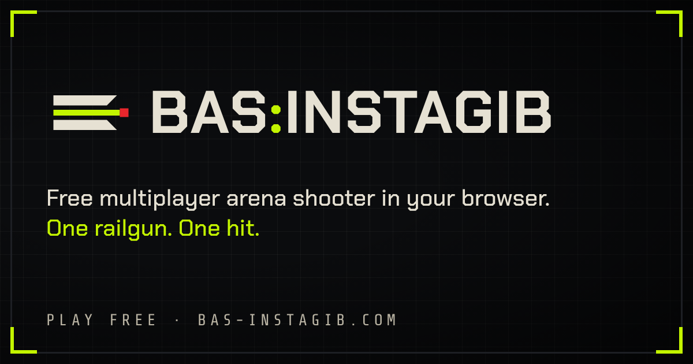</p>

<h1 align="center">BAS: Instagib – Community Server</h1>

<p align="center">
Run your own server for <a href="https://bas-instagib.com"><b>BAS: Instagib</b></a> – the free railgun arena shooter in your browser.<br>
One Docker container, one UDP port, listed in the in-game server browser within seconds.
</p>

<p align="center">
<a href="#quick-start">Quick start</a> ·
<a href="#windows-one-click-server">Windows .exe</a> ·
<a href="#settings">Settings</a> ·
<a href="#game-modes">Game modes</a> ·
<a href="#server-admins-and-the-console">Admin console</a> ·
<a href="#troubleshooting">Troubleshooting</a>
</p>

---

## At a glance

- **Deathmatch, Team Deathmatch and Duel (1v1)** – the same official image the BAS team runs.
- **Bots** that fill empty slots and leave as soon as a player joins.
- **Manage it in-game** from the console: limits, map, restart, kick, add or remove bots.
- **Your own touch**: welcome message, timed announcements, country flag, reserved slots for your clan, custom bot names.
- **Custom maps** from the browser-based map editor – players download them automatically.
- **Safe by default**: read-only file system, no root, no open TCP port, only the unmodified official code is listed.

## How it works

<p align="center">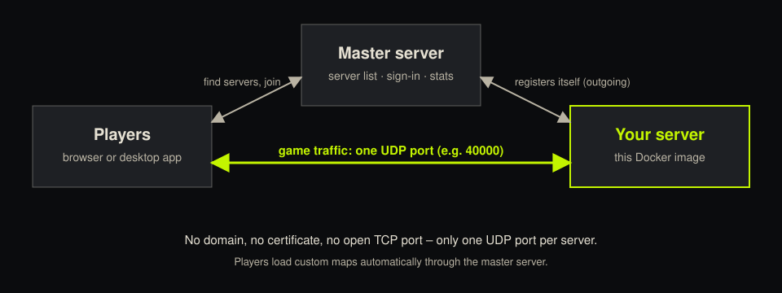</p>

Your server registers itself with the official master server through an **outgoing** connection. Players find it
in the server browser and then talk to it directly over **one UDP port**. You need no domain, no certificate and
no open TCP port.

---

## Contents

1. [Requirements](#requirements)
2. [Quick start](#quick-start)
3. [Windows: one-click server](#windows-one-click-server)
4. [Settings](#settings)
5. [Game modes](#game-modes)
6. [Bots](#bots)
7. [Server admins and the console](#server-admins-and-the-console)
8. [Welcome message, announcements and player stats](#welcome-message-announcements-and-player-stats)
9. [Spectators](#spectators)
10. [Maps and the map editor](#maps-and-the-map-editor)
11. [Firewall and ports](#firewall-and-ports)
12. [Multiple servers on one machine](#multiple-servers-on-one-machine)
13. [Updates](#updates)
14. [Troubleshooting](#troubleshooting)
15. [Verification ✓, XP and the server browser](#verification--xp-and-the-server-browser)
16. [Why a modified image is not listed](#why-a-modified-image-is-not-listed)
17. [Resource usage](#resource-usage)
18. [Stopping and removing the server](#stopping-and-removing-the-server)
19. [Legal](#legal)

---

## Requirements

- A Linux machine (VPS, dedicated server or a box at home) with a **public IPv4 address**, or port forwarding on
  your router
- **Docker Engine 24+** with the Compose plugin (`docker compose version` must work)
- Outgoing internet access (HTTPS to the master server, UDP to detect the public IP)
- One free **UDP port** per server (default `40000`)

Install Docker on Debian or Ubuntu:

```bash
curl -fsSL https://get.docker.com | sh
```

## Quick start

```bash
git clone https://github.com/vrkttr/BAS-instagib-server.git bas-server
```
```bash
cd bas-server
```
```bash
cp .env.example .env
```
```bash
nano .env
```

Set at least `BAS_SERVER_NAME` (and ideally `BAS_COUNTRY`), then start the server and watch the log:

```bash
docker compose up -d
```
```bash
docker compose logs -f
```

After about 10 seconds the log shows:

```
[bas] Master server: registered as 3f9c2a7d1b0e4c55 (wss://masterserver.bas-instagib.com/gameserver)
[bas] Master server: UDP port reachable – server is listed in the server browser
```

From then on your server is listed in the game under **Play → Server browser**. Don't forget to
[open the UDP port](#firewall-and-ports).

## Windows: one-click server

For Windows there is a ready-made launcher:
**[BAS-Instagib-Server.exe](https://github.com/vrkttr/BAS-instagib-server/releases/latest/download/BAS-Instagib-Server.exe)**
(always the latest release, built automatically from the `windows/` folder).

1. Create an empty folder, e.g. `C:\BAS-Server`, and put the exe into it.
2. Double-click the exe. On the first start it asks for the main settings and saves them in `config.env` next to
   the exe. Press `E` on a later start to change them (or start the exe with `--setup`). Every other setting from
   this README can be added to `config.env` with Notepad.
3. The launcher starts a **portable Docker engine**, pulls a **fresh** copy of the server image and starts the
   server. The window shows the server log.
4. **Closing the window stops the server** and the engine.

| Path next to the exe | Contents |
|---|---|
| `config.env` | your settings (same keys as `.env.example`) |
| `maps\` | custom maps (`.basc`), see [Maps and the map editor](#maps-and-the-map-editor) |
| `engine\` | the portable Docker engine incl. your server ID – do not delete it, or the server gets a new ID |

<details>
<summary>Requirements and notes for Windows</summary>

- Windows 10 2004+ or Windows 11 (x64) with **WSL2**. If WSL is missing, the launcher offers to run
  `wsl --install --no-distribution` (administrator prompt, then reboot). Docker Desktop is **not** needed.
- The engine is a private WSL2 distribution (Alpine Linux + Docker Engine) named `BAS-Instagib-xxxxxxxx`; it only
  runs while the window is open. The first start downloads about 300 MB.
- WSL2 does not forward UDP from your network into Linux by default, so the launcher forwards the UDP port itself.
  **Allow the firewall prompt** for the exe (private and public networks) and forward the UDP port on your router
  as described in [Firewall and ports](#firewall-and-ports).
- With `networkingMode=mirrored` in `%USERPROFILE%\.wslconfig` (Windows 11) the server uses the Windows network
  directly and no forwarding is needed.
- To remove everything: close the launcher, run `wsl --unregister BAS-Instagib-xxxxxxxx` (name shown by `wsl -l`)
  and delete the folder.

</details>

---

## Settings

All settings live in the `.env` file (Windows: `config.env`). Everything else – master server address, tick rate,
game rules, protection – is built into the image and cannot be changed. After every change:

```bash
docker compose up -d
```

### Basics

| Variable | Default | Meaning |
|---|---|---|
| `BAS_SERVER_NAME` | `BAS Community Server` | Name in the server browser (max. 48 characters) |
| `BAS_MODE` | `dm` | `dm` deathmatch, `tdm` team deathmatch or `duel` 1v1, see [Game modes](#game-modes) |
| `BAS_PORT` | `40000` | UDP port of the server (same port outside and inside) |
| `BAS_PASSWORD` | empty | Password; empty = public server |
| `BAS_MAX_PLAYERS` | `12` | Player limit (1–12; duel is always 2) |
| `BAS_COUNTRY` | empty | Two-letter country code (`DE`, `US`, `FR` …) – shows a flag in front of your server name |

### Match

| Variable | Default | Meaning |
|---|---|---|
| `BAS_MAPS` | empty = all official maps | Map pool, comma-separated, e.g. `sulfur_gate,stone_tech,mymap`. Players vote after every match |
| `BAS_FRAG_LIMIT` | `25` DM · `75` TDM · `10` duel | Kills (DM, duel) or team kills (TDM) that end the match (1–1000). `BAS_KILL_LIMIT` is the same setting |
| `BAS_TIME_LIMIT` | `10` | Time limit in minutes (1–120) |
| `BAS_TEAM_BALANCE` | `true` | TDM: players are put into the smaller team and may only switch to it. `false` lets them choose freely |

A match ends when the frag limit or the time limit is reached, whichever comes first. Always on: ready check and
countdown before every match, and a queue for full servers.

### Bots

| Variable | Default | Meaning |
|---|---|---|
| `BAS_BOTS` | `false` | `true` fills empty slots with bots, see [Bots](#bots) |
| `BAS_MAX_BOTS` | `11` | Upper limit for the number of bots (0–11) |
| `BAS_BOT_NAMES` | built-in names | Your own bot names, comma-separated, e.g. `Alpha,Bravo,Charlie` (1–24 letters, digits, spaces, `_ - .`; max. 64; no duplicates). With more bots than names they get a number (`Alpha 2`) |

### Admins and reserved slots

| Variable | Default | Meaning |
|---|---|---|
| `BAS_SERVER_ADMINS` | empty | Account IDs that may manage the server in-game, comma-separated, see [Server admins](#server-admins-and-the-console) |
| `BAS_RESERVED_SLOTS` | `0` | Slots kept free for `BAS_RESERVED_IDS` and all server admins (lower than `BAS_MAX_PLAYERS`) |
| `BAS_RESERVED_IDS` | empty | Account IDs that may use the reserved slots, comma-separated |

### Messages

| Variable | Default | Meaning |
|---|---|---|
| `BAS_MOTD` | empty | Welcome message: up to 8 lines of 120 characters, separated by `\n`, colours `^0`–`^9` |
| `BAS_BROADCAST` | empty | Announcements: up to 20 lines of 160 characters, separated by `\n` |
| `BAS_BROADCAST_INTERVAL` | `5` | Minutes between two announcements (1–120) |
| `BAS_BROADCAST_ORDER` | `sequential` | `sequential` or `random` |
| `BAS_JOIN_STATS` | `true` | Shows every signed-in player their own stats on your server after joining |

### Network

| Variable | Default | Meaning |
|---|---|---|
| `BAS_PUBLIC_IP` | detected automatically | Only set this if the detection in the log is wrong |

<details>
<summary>Example <code>.env</code> with everything in use</summary>

```
BAS_SERVER_NAME=Rail Club · DM · Germany
BAS_MODE=dm
BAS_PORT=40000
BAS_COUNTRY=DE
BAS_MAX_PLAYERS=12
BAS_TIME_LIMIT=15
BAS_FRAG_LIMIT=30
BAS_BOTS=true
BAS_MAX_BOTS=4
BAS_BOT_NAMES=Alpha,Bravo,Charlie,Delta
BAS_SERVER_ADMINS=4711
BAS_RESERVED_SLOTS=2
BAS_RESERVED_IDS=1203,1999
BAS_MOTD=Welcome to ^2Rail Club^7!\nNo camping, have fun.
BAS_BROADCAST=Vote for the next map after each match!\nJoin us on Discord: ^5discord.gg/example
BAS_BROADCAST_INTERVAL=5
BAS_BROADCAST_ORDER=random
```

</details>

---

## Game modes

| Mode | `BAS_MODE` | Players | Default frag limit | Leaderboard |
|---|---|---|---|---|
| Deathmatch | `dm` | 1–12 | 25 kills | DM |
| Team Deathmatch | `tdm` | 1–12, cyan vs. orange | 75 team kills | TDM |
| Duel | `duel` | 2, everyone else spectates in a queue | 10 kills | Duel |

### Duel

<p align="center">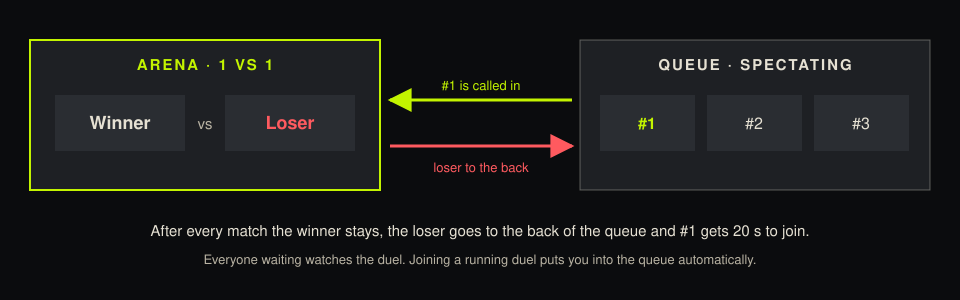</p>

`BAS_MODE=duel` runs a 1v1 server like in Quake 3. Two players fight, the **winner stays** and the **loser goes to
the back of the queue**. Everybody else watches as a spectator while waiting – joining a running duel puts you
into the queue automatically, and the game switches you in when it is your turn (you have 20 seconds). On a draw
both stay. With `BAS_BOTS=true` a lone player fights a bot until somebody joins. Duels have their own leaderboard.

---

## Bots

With `BAS_BOTS=true` the server fills itself with bots up to **one slot below full**, so there is always a free
slot for a real player:

| `BAS_MAX_PLAYERS=12` | without `BAS_MAX_BOTS` | `BAS_MAX_BOTS=6` |
|---|---|---|
| 0 players | 11 bots | 6 bots |
| 1 player | 10 bots | 6 bots |
| 6 players | 5 bots | 5 bots |
| 11 players | 0 bots | 0 bots |

- When a player joins, a bot leaves **immediately** – players never end up in the queue because of bots.
  In TDM every player replaces one bot and the bot leaves the larger team.
- Every bot has a random skill from "medium" to "really good" (reaction time, aim, turning speed, field of view,
  hearing, bunny-hopping) and a random look.
- Bots move freely through every map, including custom maps: the server builds a navigation grid from the map
  geometry when it starts (about one second per map). They also use jump pads in every direction.
- Without real players the server stays in warmup; bots alone never play a match.
- Matches with bots count **exactly like matches without bots**: XP, statistics and skill rating – even if you
  play alone against bots. For the rating, bots count as opponents with a fixed rating between 900 ("medium")
  and 1600 ("really good"). Bots have no account and never appear in leaderboards.
- The server browser shows bots next to the players; the scoreboard shows `BOT` instead of a ping.
- Server admins can add and remove bots while the server is running, see the next section.

---

## Server admins and the console

<p align="center">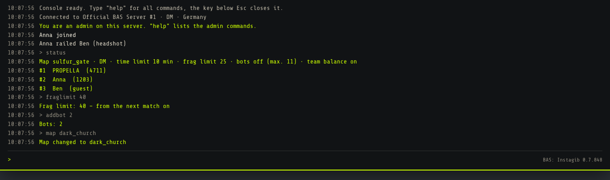</p>

Put your **account ID** into `BAS_SERVER_ADMINS`. You find it in the game under **Account → Overview → Account ID**
(with a copy button). Several admins are separated by commas:

```
BAS_SERVER_ADMINS=4711,1234
```

After `docker compose up -d`, open the **console** in the game with the key below Esc (`^` on German, `` ` `` on
US keyboards). On your server it tells you that you are an admin, and `help` lists all commands:

| Command | Effect |
|---|---|
| `status` | Settings and all players with their account IDs |
| `timelimit <1-120>` | Time limit in minutes – during a match from the next match on |
| `fraglimit <1-1000\|default>` | Frag limit – during a match from the next match on |
| `map <name>` | Changes the map right away and restarts the match |
| `restart` | Restarts the match |
| `kick <name\|#id>` | Removes a player, who cannot rejoin **this server** for 15 minutes (no penalty anywhere else) |
| `addbot [1-11]` | Adds bots (default 1) |
| `kickbot [name\|#id\|all]` | Removes one bot (without a name the last one) or all bots |
| `bots <on\|off>` · `maxbots <0-11>` · `teambalance <on\|off>` | Same as the settings of the same name |

- Console changes last until the server restarts; then the values from `.env` apply again.
- Every admin command is written to the server log with the player's name and account ID.
- Only registered accounts can be admins, never guests. Admin commands are disabled during clan wars.
- Bans for the whole game stay with the BAS team – report players in the game.

**Reserved slots:** with `BAS_RESERVED_SLOTS=2` and `BAS_RESERVED_IDS=1203,1999` the last two slots stay free
for those accounts and for every server admin. Everybody else waits in the queue once only reserved slots are
left; players with a reserved slot skip the queue. The server browser shows the server as full for everybody else
and lists the number of reserved slots in the details.

---

## Welcome message, announcements and player stats

<p align="center">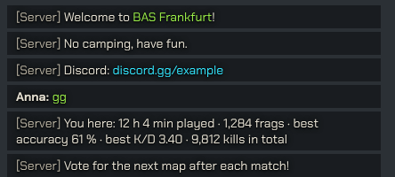</p>

Everything appears as a chat line starting with `[Server]` and fades out like normal chat.

```
BAS_MOTD=Welcome to ^2My BAS Server^7!\nNo camping, have fun.\nDiscord: ^5discord.gg/example
BAS_BROADCAST=Vote for the next map after each match!\nJoin our Discord: ^5discord.gg/example
BAS_BROADCAST_INTERVAL=5
BAS_BROADCAST_ORDER=random
```

- **Welcome message** (`BAS_MOTD`): shown when a player joins and after every map change.
- **Announcements** (`BAS_BROADCAST`): one line every `BAS_BROADCAST_INTERVAL` minutes, in order or at random –
  only while at least one player is on the server.
- **Player stats** (`BAS_JOIN_STATS`, on by default): 3 seconds after joining, every signed-in player sees their
  playtime and frags on your server, their best accuracy and best K/D here, and their total kills. Only verified
  servers (✓) collect stats, so on other servers this line does not appear.

| Code | `^0` | `^1` | `^2` | `^3` | `^4` | `^5` | `^6` | `^7` | `^8` | `^9` |
|---|---|---|---|---|---|---|---|---|---|---|
| Colour | dark grey | red | green | yellow | blue | cyan | pink | white | orange | grey |

---

## Spectators

Every server accepts **any number of spectators**. They do not take a player slot, do not appear in the player
list and do not vote; the scoreboard shows how many are watching. Players join with **Spectate** in the server
browser or switch with Esc → **Spectate** / **Join the game**.

- Spectating works on **password-protected servers** without the password (e.g. for e-sports matches); the
  password is only asked for when switching into the game.
- Camera: free camera, first-person view of a player, or **Auto**, where the camera picks the best players and
  shots by itself.
- For a permanent stream (OBS, Twitch) open `https://bas-instagib.com/?watch=<server ID>&auto` as a browser
  source: it starts directly as a spectator in Auto mode, without any menu.

---

## Maps and the map editor

The official maps are built into the image. If `BAS_MAPS` is empty, the server plays **all of them**, starts
with a random one and lets the players vote after every match; new official maps join the pool automatically
with every update.

<table>
<tr><td align="center" width="33%">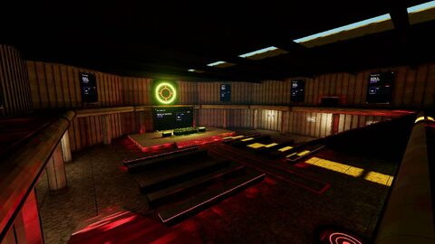<br><b>Dark Church</b><br><code>dark_church</code></td><td align="center" width="33%">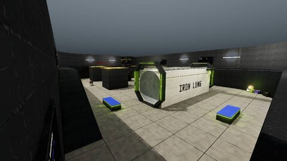<br><b>Iron Lung</b><br><code>iron_lung</code></td><td align="center" width="33%">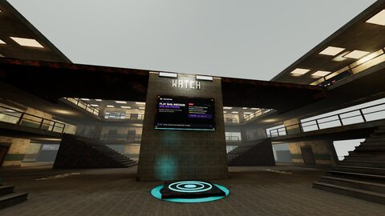<br><b>Lakeside Prison</b><br><code>lakeside_prison</code></td></tr>
<tr><td align="center" width="33%">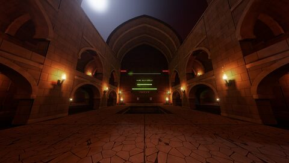<br><b>Medieval Techno</b><br><code>medieval_techno</code></td><td align="center" width="33%">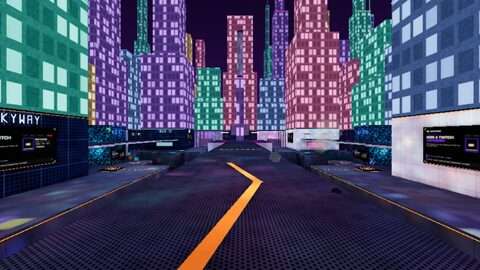<br><b>Neo City</b><br><code>neo_city</code></td><td align="center" width="33%">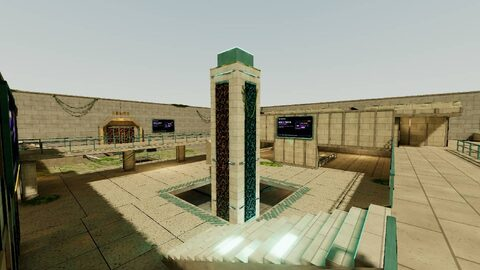<br><b>Stone Tech</b><br><code>stone_tech</code></td></tr>
<tr><td align="center" width="33%">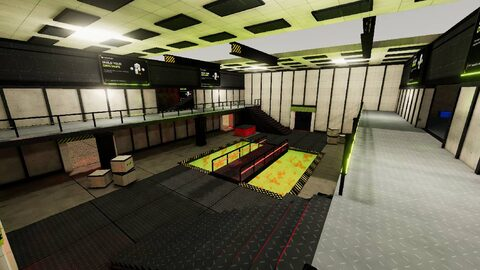<br><b>Sulfur Gate</b><br><code>sulfur_gate</code></td><td align="center" width="33%">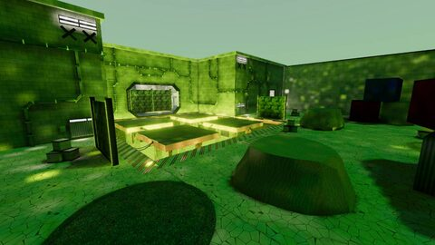<br><b>Toxic Core</b><br><code>toxic_core</code></td><td align="center" width="33%">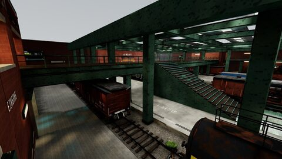<br><b>Train Wrack</b><br><code>train_wrack</code></td></tr>
</table>

If you set `BAS_MAPS`, only your selection is played – new official maps then have to be added by hand.

**Custom maps** are made in the browser with the **BAS map editor**: <https://mapeditor.bas-instagib.com>.

1. **Build** the map from modular parts (floors, walls, stairs, ramps, platforms, doors, jump pads …).
   A **jump pad** launches players straight up, or – with **Set target** – in an arc onto any spot you click;
   the editor shows the flight path in green. Add **spawn points** (for TDM ideally team spawns `cyan` and
   `orange`), ad panels at visible spots, and kill volumes for pits.
2. **Test** it with **▶ Test in game** – real movement, before anyone else plays it.
3. **Bake** the lighting with **☀ Bake** (runs in your browser on all CPU cores).
4. **Export** – you get `<mapname>.basc`.
5. Put the file into `maps/` next to `compose.yaml` (Windows: `maps\` next to the exe).
6. Add it to the pool together with the official maps you want to keep, e.g.
   `BAS_MAPS=dark_church,iron_lung,sulfur_gate,mymap`, then `docker compose up -d`.

- The **file name** without `.basc` is the identifier (letters, digits, `-`, `_`) and must match `BAS_MAPS`.
- Players need nothing: they download the map automatically when they join (up to 64 MB per map), and get new
  versions automatically after you overwrite the file.
- [Bots](#bots) play custom maps too.

---

## Firewall and ports

The only port to open is the UDP port from `BAS_PORT`, e.g. with `ufw`:

```bash
sudo ufw allow 40000/udp
```

- **Same port outside and inside** – also when forwarding the port on a router.
- **Cloud providers** (Hetzner, netcup, AWS, Oracle …): open the port in their firewall/security group as well.
- No TCP port is needed; the connection to the master server is outgoing.

## Multiple servers on one machine

Every server needs its **own UDP port** and its **own data volume** (which holds its server ID).

**Option A – one folder per server:** clone the repository once per server, give each `.env` a different
`BAS_PORT` (e.g. 40001, 40002) and run `docker compose up -d` in each folder.

**Option B – one file:** `examples/multi-server.compose.yaml` starts four servers (DM and TDM, each public and
password-protected) on ports 40001–40004:

```bash
cp examples/multi-server.env.example examples/.env
```
```bash
nano examples/.env
```
```bash
docker compose -f examples/multi-server.compose.yaml up -d
```

To add a server there, copy a block under `services:`, change name, port (in both places) and volume, and add the
volume at the bottom. Every setting from this README can go into its `environment:` block.

## Updates

**Servers must be up to date**, otherwise the master server rejects them (see
[below](#why-a-modified-image-is-not-listed)). Updates also bring new features and official maps.

```bash
docker compose pull
```
```bash
docker compose up -d
```

Automatically every night at 4 am (`crontab -e`):

```
0 4 * * * cd /path/to/bas-server && docker compose pull -q && docker compose up -d
```

The server ID is kept across updates.

---

## Troubleshooting

```bash
docker compose logs -f --tail=200
```

Every line starts with a UTC timestamp. On startup the server prints its version, build ID, all settings, the
loaded maps, the detected public IP and the state of the master server connection; after that joins, leaves,
match phases, map changes, admin commands and a status line once per minute.

| Log message | Cause | Fix |
|---|---|---|
| `UDP port reachable – server is listed in the server browser` | all good | – |
| `UDP port NOT reachable` | firewall/port forwarding missing or wrong IP | open the UDP port (also at your cloud provider), same port outside and inside, set `BAS_PUBLIC_IP` if needed |
| `public IP could not be detected` | outgoing UDP is blocked | set `BAS_PUBLIC_IP=<your IPv4>` |
| `REJECTED: Server code does not match the official build` | image outdated or modified | `docker compose pull && docker compose up -d` |
| `Master server protocol … not supported` | image outdated | update |
| `not reachable (wss://masterserver…)` | no internet/DNS, or the master server is briefly offline | check the network; the server keeps retrying |
| `Configuration error: …` | invalid value in `.env` | the message names the variable and the allowed values |
| `Map "xyz.basc" not found` | file missing in `maps/` or typo in `BAS_MAPS` | check the file name |
| `Too many servers from this address` | protection limit of the master server | contact the BAS team |
| `ID only valid until restart` | volume for `/app/data` is missing | use the compose file from this repository |

`docker compose ps` shows the container health. When reporting a problem, include the first ~40 lines after
startup (`docker compose logs --tail=300`). Passwords are never written to the log.

---

## Verification ✓, XP and the server browser

<p align="center">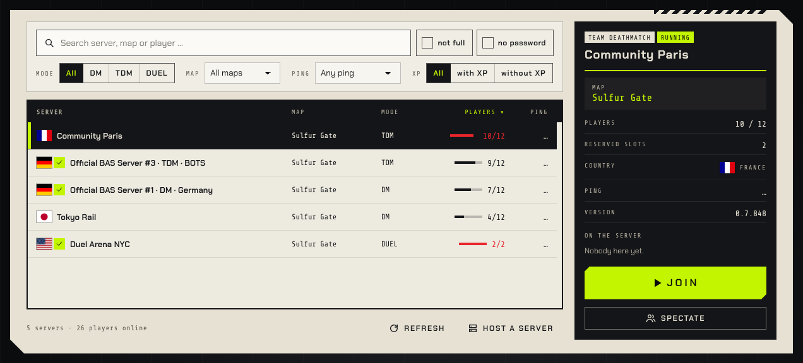</p>

On first start the server creates a key in its data volume. The **server ID** (16 characters) is derived from it,
printed in the log, and stays the same as long as the volume exists.

**Verified servers ✓** – with or without password or bots – count fully: XP, daily challenges, statistics and
skill rating. **Servers that are not verified** count for nothing. Players can filter the browser by
*with XP* / *without XP*. Verification is granted by the BAS team based on the server ID – just ask.

## Why a modified image is not listed

So that the same rules apply everywhere, the master server **only accepts the unmodified official image**. On
every registration the server proves with a one-time random value that its code matches the official build byte
for byte. A modified or outdated server is rejected (`REJECTED` in the log). The image runs without root
privileges on a read-only file system.

## Resource usage

Per server with 12 players roughly 1 CPU core (128 Hz simulation), 150 MB RAM and 1–2 Mbit/s upload. A small VPS
with 2 cores easily handles two full servers. Bots need no bandwidth; 11 bots take about an eighth of a core.

## Stopping and removing the server

```bash
docker compose down
```

Also delete the server ID (the server gets a new one on the next start):

```bash
docker compose down -v
```

---

## Legal

© 2026 David Vierkötter ("VRKTTR"). All rights reserved. The image may only be used unmodified to run a
BAS: Instagib server. See [LICENSE](LICENSE).

The image contains third-party components under their own licenses (among them node-datachannel and
libdatachannel under the Mozilla Public License 2.0). The full list with all license texts is in the image at
`/app/third-party-licenses.txt` and online at <https://bas-instagib.com/third-party-licenses.txt>.

Official website: <https://bas-instagib.com>
